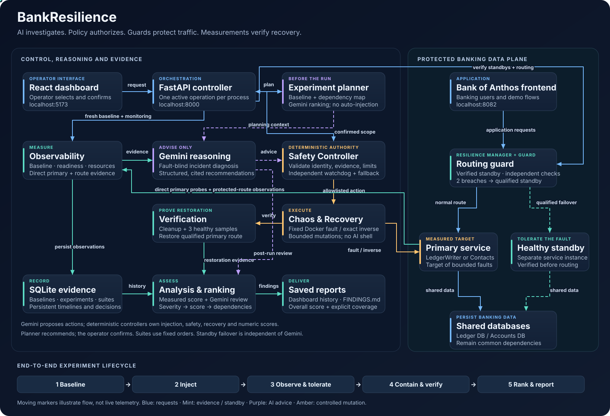
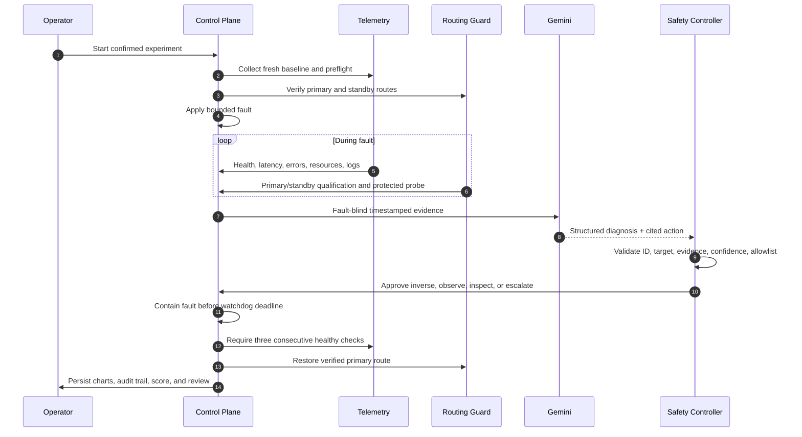

<div align="center">

# BankResilience

### AI-assisted network telemetry, transfer-path anomaly investigation, and automated resilience for financial systems

**Observe the baseline. Inject a controlled failure. Follow the evidence. Keep critical traffic moving.**

[](#project-status)
[](#technology-stack)
[](#technology-stack)
[](#technology-stack)
[](#technology-stack)
[](#ai-with-guardrails)
[](#license)

Built around the [Bank of Anthos](https://github.com/GoogleCloudPlatform/bank-of-anthos) microservice application.

</div>

---

## Why BankResilience

Financial systems depend on more than healthy processes. A service can be running while the path to it is slow, misrouted, intermittently unavailable, or serving traffic from an unintended destination. In a payments system, those routing anomalies can create timeouts, ambiguous writes, cascading retries, and difficult incident investigations.

BankResilience is a local resilience and investigation control plane for those moments. It establishes a measured baseline, runs bounded failure experiments, correlates service health with network and application evidence, asks Gemini for a structured diagnosis, applies only allowlisted recovery actions, and verifies that the system actually returned to health.

The Resilience Agent prepares verified standby instances for critical Bank of Anthos services and places an independent routing guard in front of them. If the primary becomes unavailable or persistently slow, the guard shifts new traffic to a qualified standby while the original fault remains active long enough to measure tolerance.

> **Designed for proof, not theater.** Failed probes remain failures, AI output is labeled, every mutation is constrained by deterministic policy, and recovery succeeds only after fresh readiness checks pass.

### What it protects against in the lab

| Risk pattern | Controlled signal | Detection and response |
|---|---|---|
| Route degradation or hijack-like path behavior | Added latency and jitter on the LedgerWriter path | Baseline-relative thresholds, route-health streaks, topology evidence, standby routing |
| Intermittent transport failure | 60% bounded packet loss on the LedgerWriter path | Error/availability series, primary-route disqualification, verified standby routing |
| Resource exhaustion | Two bounded CPU workers inside LedgerWriter | Target CPU threshold, latency correlation, exact worker termination |
| Critical service outage | LedgerWriter stopped | Availability/error breach, verified standby, fixed `start-service` inverse |
| Unresponsive dependency | Contacts process paused | Readiness failure, caller-impact analysis, fixed `unpause-service` inverse |
| Ambiguous transfer outcome | A write times out after dispatch | No automatic replay; outcome is recorded as ambiguous for reconciliation |
| AI delay or malformed advice | Timeout, invalid JSON, missing evidence, identity mismatch | Deterministic fallback and an independent fault watchdog |

BankResilience models **BGP-hijack-inspired symptoms** at the application-path layer; it does not operate a BGP daemon or inspect Internet routing tables. Its transfer probes verify application responses, not end-to-end ledger correctness. See [Threat model and trust boundaries](#threat-model-and-trust-boundaries).

## System architecture



Moving markers show flow direction, not live telemetry. **Blue** carries requests, **mint** carries observations and standby traffic, **purple** carries AI advice, and **amber** carries controlled fault/recovery actions. The routing guard performs failover independently of Gemini; the Safety Controller validates every recovery action. The diagram remains readable when SVG animation is disabled.

[Open the animated SVG](frontend/public/bankresilience-architecture.svg)

### Evidence flow



## Core capabilities

### Interactive Corrupt Transfer Routing Experiment

This evaluator-facing workflow tells the story of a transfer path that becomes suspicious while financial traffic is in flight. The implemented scenario combines the **Network slowdown** experiment, authenticated Bank of Anthos probes, protected standby routing, dependency topology, and captured forensic evidence.

It is a controlled, BGP-hijack-inspired exercise: the lab introduces path latency and jitter rather than advertising malicious BGP routes. That makes it repeatable on a laptop while preserving the incident-response questions that matter—**when did the route degrade, what was affected, was traffic protected, what evidence justified the action, and did the primary recover?**

| Dashboard surface | What the evaluator sees | Why it matters |
|---|---|---|
| **Top KPI cards** | Experiment phase, active services, resilience score, and AI mode | Establishes system state at a glance |
| **Multi-phase time series** | Steady State → Attack/Fault → Intervention → Recovery for latency, availability, errors, CPU, and memory | Makes cause, containment, and recovery visually comparable |
| **Network impact topology** | Live Bank of Anthos dependency graph with service state and potential caller impact | Separates measured impact from possible blast radius |
| **Attack-signature forensic console** | Timestamped probes, target logs, route observations, thresholds, decisions, and executed actions | Creates an auditable incident narrative |
| **Protected-flow evidence** | Standby observations, protected-route availability/p95, authenticated home checks, and optional demo payments | Demonstrates whether the application remained usable |
| **Recovery report** | Detection, mitigation, recovery duration, baseline restoration, score penalties, and Gemini review | Proves recovery with measurements |

```text
┌──────────────────┬────────────────────┬────────────────────┬──────────────────┐
│   STEADY STATE   │   ATTACK / FAULT   │    INTERVENTION    │     RECOVERY     │
│ baseline median  │ latency + jitter   │ standby protected  │ primary verified │
│ healthy primary  │ primary degraded   │ inverse approved   │ routing restored │
└──────────────────┴────────────────────┴────────────────────┴──────────────────┘
```

Optional one-cent payments use the local demo account and are never automatically retried. A missing response is recorded as ambiguous because replaying a financial write after a timeout could create a duplicate.

### Experiment Suite Agent

One button runs the complete catalogue in a safe sequence:

1. Collect a fresh ten-sample baseline.
2. Verify infrastructure and standby readiness.
3. Run LedgerWriter outage, network slowdown, packet loss, CPU stress, and Contacts hang one at a time.
4. Hold each fault for a bounded tolerance window while protected traffic remains healthy.
5. Restore and verify the primary before starting the next experiment.
6. Persist per-fault KPIs and generate a measured summary with optional Gemini analysis.

**Stop suite and restore service** cancels the active run, performs the fixed inverse, and prevents the next injection. A failed preflight or unverified recovery also stops the sequence.

### Resilience Agent

The Resilience Agent prepares standby LedgerWriter and Contacts services using the existing local images and configuration. Dedicated routing guards probe primary and standby independently:

- Two consecutive failures or responses slower than 300 ms make the current route ineligible.
- A standby must produce two recent healthy samples before receiving traffic.
- One isolated outlier does not cause route flapping.
- Failover is sticky until recovery verification explicitly restores the primary.
- Writes are dispatched once. The guard never retries an uncertain financial operation.
- If both routes fail, the guard returns `503` and the controller contains the experiment.

Network slowdown stays active for at most 10 seconds. Outage, packet loss, CPU stress, and hang experiments are capped at 12 seconds. Packet loss uses an independently expiring 60% `netem` policy. CPU stress uses two target-container workers with a separate self-termination timer. The fault therefore remains observable long enough to demonstrate protected operation before cleanup.

### Why the default suite is sequential

The five-fault suite intentionally injects one fault at a time. That preserves causal attribution: the report can state which mutation produced each latency, error, availability, and resource change.

The **Run fault combinations** button runs two approved LedgerWriter pairs: **network slowdown + CPU stress**, then **packet loss + CPU stress**. Both components overlap within each experiment; the next pair waits for verified recovery. Every mutation has its own expiry timer and exact inverse, and cleanup attempts both inverses even if one fails. Reports record component injection times, cleanup results, and comparisons with available historical single-fault scores. Different baselines can influence these comparisons; arbitrary combinations are not supported.

### Dependency-aware scoring and findings

The Gemini planner ranks experiments using the service dependency map, baseline evidence, and prior runs, with short justifications. `backend/planner.py` aggregates completed runs: severity first, lower measured score next, then dependency criticality as a tie-breaker. The dashboard explains score penalties and potential downstream callers beside each weakness, and displays saved Gemini remediation proposals separately from executed recovery actions.

The **Overall System Resilience Score** is the equal-weight mean of the latest completed score for each single-fault type. Coverage is explicit; repeated and combined runs do not inflate it. Scores measure primary-probe resilience, not a production SLA or transaction correctness.

The dashboard's **Findings report & system improvements** panel lets you **Generate/Refresh findings**, **View report**, and **Download FINDINGS.md**. Improvement cards show saved Gemini proposals with priority, affected service, experiment ID, supporting evidence, and how to validate each change. They are recommendations to evaluate, not automatically deployed changes.

The report is a saved snapshot of the latest recovered runs of the three original experiments. Refresh it after new runs; generating it reads saved history and does not call Gemini, inject faults, or submit payments. A matching `FINDINGS.json` stores structured recommendations and a Markdown content hash. If the Markdown is edited separately, the dashboard keeps it accessible and asks you to refresh before showing synchronized cards. The broader five-fault ranking remains in System Weakness Ranking.

[**FINDINGS.md**](FINDINGS.md) contains the three original experiments, evidence IDs, severity-ranked findings, saved Gemini recommendations, and verification steps. Regenerate it from persisted evidence without injecting faults:

```bash
cd backend
.venv/bin/python findings.py
```


### AI with guardrails

Gemini receives timestamped evidence—not unrestricted infrastructure access. Pydantic validates every structured response, and the deterministic controller remains authoritative.

| Gemini can | Gemini cannot |
|---|---|
| Rank available experiments | Execute shell commands |
| Diagnose from scoped telemetry and logs | Invent a service, host, or route |
| Cite evidence and recommend a permitted action | Bypass the active experiment ID or target allowlist |
| Request bounded observation or read-only inspection | Extend the absolute fault deadline |
| Produce a post-recovery engineering review | Rewrite measured KPIs or the resilience score |

When Gemini is unavailable, slow, or invalid, BankResilience uses an explicitly labeled deterministic fallback. The independent watchdog continues running while AI is being called.

### Persistent evidence and explainable scoring

SQLite stores baselines, experiment timelines, suite reports, diagnoses, actions, and recovery verification. Historical curves remain selectable after the live experiment finishes.

```text
score = 100
      − target errors − p95 latency degradation − frontend errors
      − detection delay − mitigation delay − recovery duration
      − observed blast radius − unverified restoration
```

AI may explain the score; it cannot change it. Failed probes count as errors and are never converted into zero-latency successes.

## Threat model and trust boundaries

### Assets

- Availability of LedgerWriter, Contacts, and authenticated Bank of Anthos flows
- Integrity of transfer execution semantics—especially avoiding duplicate writes
- Routing configuration and recovery state
- Experiment evidence, audit history, and Gemini credentials

### Adversary and failure assumptions

The lab assumes a single primary service can fail or its application path can become degraded. The observed symptoms resemble route leaks, BGP hijacking, blackholing, congestion, or a compromised intermediary, but the experiment does not attribute a real-world network cause without external routing evidence.

### Controls

| Boundary | Control |
|---|---|
| Operator → experiment | Explicit confirmation, one active operation, kill switch |
| AI → infrastructure | Typed schema, evidence citations, fixed target/action allowlists |
| Control plane → Docker | Known Compose project, service identity checks, exact recovery inverse |
| Gateway administration | Private generated token, loopback-only admin port |
| Financial writes | One dispatch, no retry after timeout, ambiguous-outcome reporting |
| Secrets | Gemini key stays in the backend; tokens and account IDs are omitted from reports |
| Recovery claims | Three consecutive readiness checks and fresh post-fault measurements |

### Out of scope

- Real Internet BGP monitoring, RPKI validation, or route-origin authorization
- Cryptographic detection of altered transaction payloads
- Shared database failure or simultaneous primary/standby compromise
- Multi-region consensus, disaster recovery, and production traffic engineering
- Proof of ledger correctness from an HTTP success response alone

These boundaries make BankResilience a strong **local investigation and resilience demonstrator**, not a replacement for production fraud detection, RPKI, a service mesh, or ledger reconciliation.

## Technology stack

| Layer | Technology | Role |
|---|---|---|
| Dashboard | React 19, Vite 8, Lucide React | Live KPIs, charts, topology, timelines, suite controls |
| API and orchestration | Python 3.10+, FastAPI, Uvicorn, Pydantic | Experiment lifecycle, validation, APIs, structured contracts |
| AI reasoning | Google Gemini structured JSON output | Planning, scoped diagnosis, resilience advice, post-analysis |
| Infrastructure control | Docker SDK for Python | Health inspection, bounded faults, standby lifecycle |
| Protected data plane | Python HTTP routing guards | Active/standby qualification and single-dispatch proxying |
| Telemetry and evidence | HTTP readiness, Docker state/stats/logs, SQLite | Baselines, time series, audits, persistent reports |
| Target system | Bank of Anthos | Financial microservice testbed |

## Local quick start

### Prerequisites

- macOS or Linux with Docker running
- A local Bank of Anthos deployment using Compose project `bank-of-anthos-local`
- Python 3.10+
- Node.js with npm
- Optional: a Gemini API key for live AI reasoning

> The takeover environment expects Bank of Anthos at `http://localhost:8082` with eight Compose services. Restore the original Bank of Anthos checkout and configuration before recreating that deployment; do not guess manifests or keys.

### 1. Start Bank of Anthos

```bash
docker start $(docker ps -aq --filter label=com.docker.compose.project=bank-of-anthos-local)
docker ps --filter label=com.docker.compose.project=bank-of-anthos-local
```

Confirm the application opens at [http://localhost:8082](http://localhost:8082).

### 2. Configure and run the backend

```bash
cd bankresilience/backend
python3 -m venv .venv
.venv/bin/python -m pip install -r requirements.txt
cp ../.env.example .env
```

Edit `backend/.env` if needed:

```dotenv
DOCKER_HOST=unix:///Users/your-name/.docker/run/docker.sock
GEMINI_API_KEY=
GEMINI_MODEL=gemini-3.1-flash-lite
GEMINI_TIMEOUT_SECONDS=8
```

Start one control-plane process:

```bash
.venv/bin/python -m uvicorn main:app --host 127.0.0.1 --port 8000
```

Without a Gemini key, the platform remains functional in visibly labeled deterministic fallback mode.

### 3. Run the dashboard

```bash
cd bankresilience/frontend
npm ci
cp .env.example .env.local
npm run dev
```

- Dashboard: [http://localhost:5173](http://localhost:5173)
- API documentation: [http://127.0.0.1:8000/docs](http://127.0.0.1:8000/docs)

### 4. Run your first investigation

1. Click **Collect baseline**.
2. Click **Recommend experiments** for an evidence-based ranking.
3. Select **Network slowdown** for the Corrupt Transfer Routing scenario.
4. Leave **Keep traffic usable with the Resilience Agent** enabled.
5. Confirm and watch the primary and protected-route charts diverge.
6. Inspect the diagnosis, topology, forensic timeline, recovery verification, and saved report.

For the complete demonstration, click **Run all faults** in the Experiment Suite Agent.

## API map

| Method | Endpoint | Purpose |
|---|---|---|
| `GET` | `/api/health` | Control-plane and Docker connectivity |
| `GET` / `POST` | `/api/baseline` | Read or collect persistent baseline telemetry |
| `POST` | `/api/planner` | Rank the experiment catalogue |
| `GET` | `/api/experiments` | List supported experiments |
| `POST` | `/api/experiments/{kind}` | Start one confirmed bounded experiment |
| `POST` | `/api/kill-switch` | Request immediate containment |
| `GET` | `/api/history` | Retrieve saved experiment evidence |
| `GET` / `POST` | `/api/findings` | Read the saved report and insights / regenerate from history |
| `GET` | `/api/findings/download` | Download the saved Markdown report |
| `GET` / `POST` | `/api/suites` | Retrieve or launch the sequential suite |
| `POST` | `/api/suites/cancel` | Restore the active fault and cancel remaining runs |
| `POST` | `/api/resilience/enable` | Prepare standbys and protected routing |
| `POST` | `/api/resilience/disable` | Restore original routing and remove owned helpers |
| `POST` | `/api/recovery/verify` | Perform ten fresh restoration checks |
| `GET` | `/api/analysis` | Compare latest measured results by fault type |

Supported experiment kinds are `ledgerwriter-outage`, `network-slowdown`, `packet-loss`, `cpu-stress`, and `contacts-pause`.

## Validation

```bash
cd backend
PYTHONPYCACHEPREFIX=/tmp/bankresilience-cache \
  .venv/bin/python -m unittest discover -s tests -v

cd ../frontend
npm test
npm run build
```

| Check | Result |
|---|---:|
| Backend tests | 80 passing |
| Frontend tests | 3 passing |
| Production build | Passing |
| Live local Docker experiments | Outage, slowdown, and hang exercised |

Tests cover safety allowlists, identity matching, malformed AI responses, watchdog recovery, gateway authorization, single-dispatch writes, standby qualification, payment budgets, cancellation, suite ordering, restoration, and tolerance verification.

## Three-minute hackathon demo

| Time | Show | Key message |
|---:|---|---|
| `0:00–0:25` | Baseline, eight-service topology, Docker connection | The system begins with measured evidence |
| `0:25–1:15` | Packet loss or Corrupt Transfer Routing / Network slowdown | Errors or latency degrade while verified standby traffic remains usable |
| `1:15–1:50` | Time series, KPI cards, protected-route metrics | Steady State → Attack → Recovery is visible and quantified |
| `1:50–2:20` | Forensic timeline and Gemini diagnosis | Advice cites current evidence and cannot execute arbitrary actions |
| `2:20–2:40` | Recovery verification and score | The platform proves restoration with fresh checks |
| `2:40–3:00` | Experiment Suite Agent and saved reports | One button produces a repeatable resilience assessment |

## Project status

BankResilience is an active hackathon prototype and local resilience lab. It demonstrates a production-minded operating model—measured baselines, bounded experiments, constrained AI, fail-safe recovery, and honest evidence boundaries—on a system that runs on a developer laptop.

The strongest next steps are an allowlisted combined-fault runner, real BGP/RPKI signal ingestion, signed transfer-path provenance, independent ledger reconciliation, a durable external watchdog, multi-region standby qualification, and OpenTelemetry-compatible traces.

## Hackathon context

BankResilience was created to answer a practical challenge: **can AI make a complex financial incident easier to understand without being trusted to take arbitrary infrastructure actions?**

The project pairs the visual clarity expected in a hackathon demonstration with controls expected in serious systems engineering. Gemini accelerates investigation and explains evidence; deterministic policy owns safety, action scope, and recovery verification.

## Responsible use

Run BankResilience only against a local or explicitly authorized test environment. Fault injection intentionally stops, pauses, or degrades services. Do not point this control plane at production infrastructure, real customer accounts, or real financial networks.

## License

BankResilience is available under the [MIT License](LICENSE). Copyright © 2026 BankResilience contributors.

---

<div align="center">

**BankResilience** · Controlled failure, measured recovery, evidence before action.

</div>
